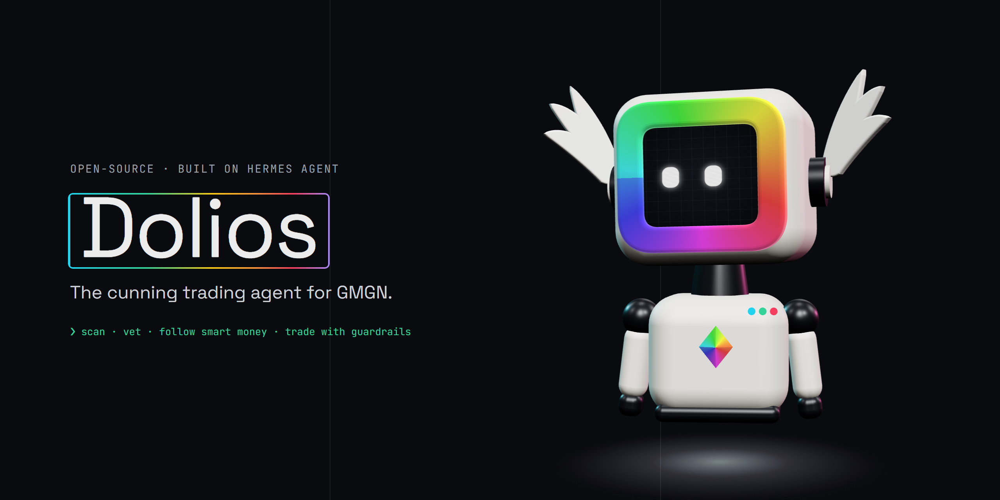

<p align="center">
  
</p>

# Dolios ◆

**The cunning trading agent for GMGN.** Dolios is an open-source AI agent that researches and trades
on-chain tokens on Solana, BSC, Base and Ethereum through [GMGN](https://gmgn.ai)'s official Agent API —
in plain English, from your terminal, Telegram or Discord.

It is a distribution of [Hermes Agent](https://github.com/NousResearch/hermes-agent) by Nous Research,
so it keeps everything Hermes does — memory across sessions, self-improving skills, subagents, scheduled
jobs, any LLM provider — and adds a trading desk on top.

> Dolios gives information, not financial advice. Meme tokens can go to zero. Use a dedicated trading
> wallet with funds you can afford to lose.

## What it does

| | |
|---|---|
| **Scans the trenches** | Trending tokens by the minute, new launches on pump.fun / letsbonk / fourmeme / clanker, hot searches, K-lines. |
| **Vets before you buy** | Resolves a name to the right contract among copycats, then checks liquidity, honeypot, rug ratio, holder concentration, bundlers, insiders, snipers and the dev's launch history. |
| **Follows the smart money** | Live Smart Money / KOL / followed-wallet trades, wallet scoring, copy-tradeability and trading-style tags. |
| **Trades with guardrails** | Market, limit, take-profit, stop-loss and trailing orders via `gmgn-cli`. Every order is restated in one line and needs your approval — even in yolo mode. |
| **Remembers you** | Your risk limits, favourite chains and past trades carry across sessions. |

## Install

**Windows (PowerShell)**

```powershell
irm https://raw.githubusercontent.com/DoliosAgent/dolios/main/install-dolios.ps1 | iex
```

**macOS / Linux / WSL**

```bash
curl -fsSL https://raw.githubusercontent.com/DoliosAgent/dolios/main/install-dolios.sh | bash
```

The installer sets up Python, Node.js and dependencies (via the Hermes package manager) in its own
folder, installs [`gmgn-cli`](https://www.npmjs.com/package/gmgn-cli), and adds the `dolios` command.
During setup you pick an LLM provider (OpenRouter, Anthropic, OpenAI, Nous Portal, a local model, …).

## Connect GMGN

Start `dolios` and say **"connect my GMGN account"**. Dolios runs `gmgn-cli config`, which creates a
signing key on your machine and gives you a link to create a GMGN API key bound to it. Paste the API key
back and you're done.

- Dolios **never** asks for your wallet's private key or seed phrase. GMGN doesn't need it.
- The signing key stays in `~/.config/gmgn/.env` on your computer.
- GMGN's API only works over IPv4.

## Try

```text
what's hot on solana in the last hour?
is 7xKXtg2CW87d97TXJSDpbD5jBkheTqA83TZRuJosgAsU safe?
buy 0.2 SOL of the real $WIF, stop loss -30%
which smart money wallets bought in the last 30 minutes?
score this wallet and tell me if it's worth copying: <address>
sell 50% of my BONK
```

## Safety model

- **Trade guard.** Commands that move funds (`swap`, `multi-swap`, `order strategy create|cancel`,
  `cooking create`) always stop for your approval, per exact command — `/yolo` and
  `approvals.mode: off` do not skip it. Scheduled or unattended runs are blocked from trading unless you
  explicitly set `approvals.trade_autopilot: true` in `config.yaml`.
- **Due diligence first.** Buys by name go through contract resolution and security checks before
  execution.
- **No custody.** Orders are signed by your local key and executed by GMGN; Dolios holds no funds.

## Credits & license

- [Hermes Agent](https://github.com/NousResearch/hermes-agent) © Nous Research — MIT. The original
  README is kept as [README.hermes.md](README.hermes.md).
- [GMGN Agent Skills](https://github.com/GMGNAI/gmgn-skills) © GMGN — MIT, bundled in
  `skills/trading/` (see `skills/trading/LICENSE-GMGN`).
- Dolios changes: MIT, see [LICENSE](LICENSE).

Dolios is an independent project and is not affiliated with or endorsed by Nous Research or GMGN.
